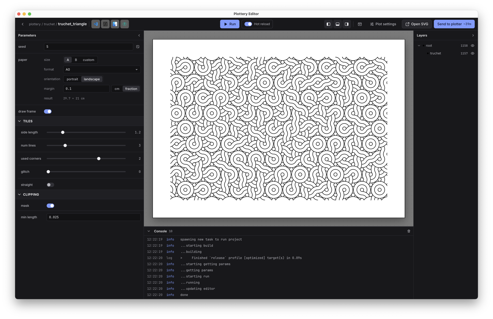
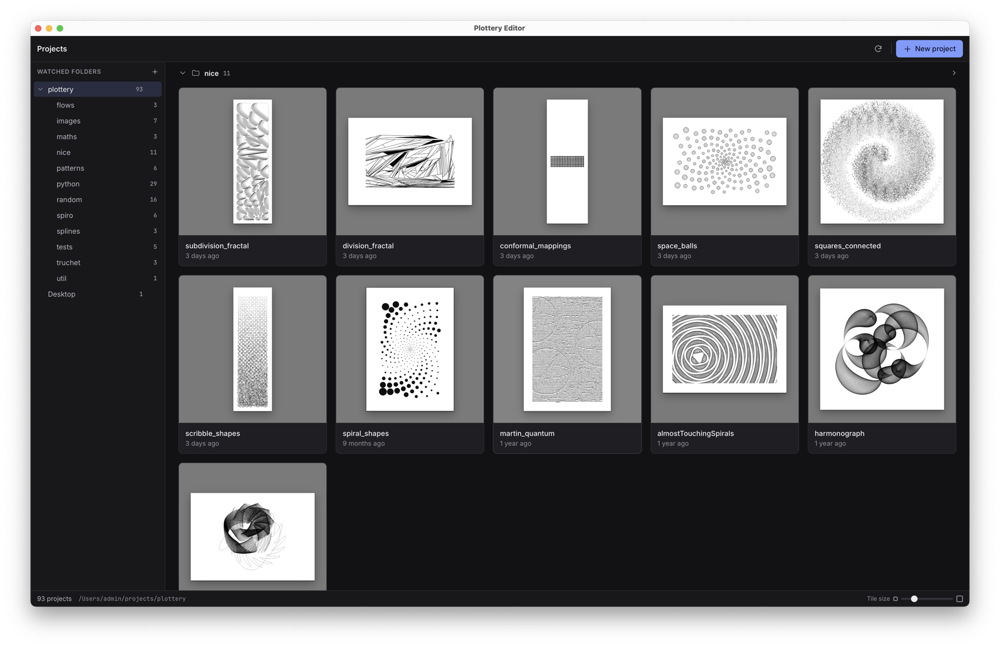

# Plottery Editor

Part of [**Plottery**](../README.md), a generative art engine for pen-plotters.

The macOS desktop app to manage, preview and plot **Plottery** projects. Install it with the one-line [install script](../README.md#install), or download the DMG from the [releases](https://github.com/TobiasGrothmann/plottery/releases).



- **Project browser:** your project folders as tiles with previews. Create new projects from here.
- **Params panel:** every field of a project's `Params` as a widget, with sections and tooltips. Changes re-run the project.
- **Hot reload:** saving a source file rebuilds and re-renders the project.
- **Variations:** tick params and roll them to random values, numbers within a range you set, anywhere or near the current values, or as a grid of every combination (samples per number, a keep chance to roll only part of them), see the results side by side, click one to roll from it and double-click it to edit it, press Y to see it fullscreen next to the start, each side zooming on its own. The arrow keys move through the rolls, also in fullscreen (F) and next to the start. Rolls made with `plottery roll` show up as they finish.
- **Layers:** inspect the sublayers of the result and toggle them in the preview.
- **Plotting:** send the result to a [Plottery server](../server) and control the plotter remotely.



## Build from source

Needs the [Dioxus CLI](https://dioxuslabs.com/learn/0.7/getting_started) (`dx`):

```sh
cd editor
dx serve            # run a dev build
```

`../scripts/release_editor.sh <version> false` builds the release DMG without uploading it. See [DEVELOPMENT.md](../DEVELOPMENT.md).
