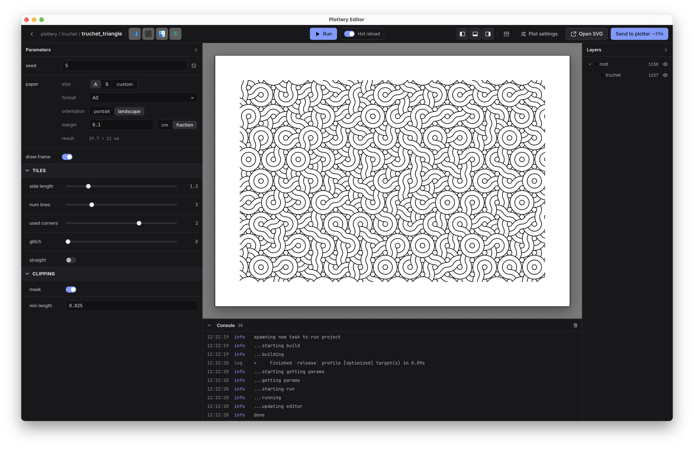
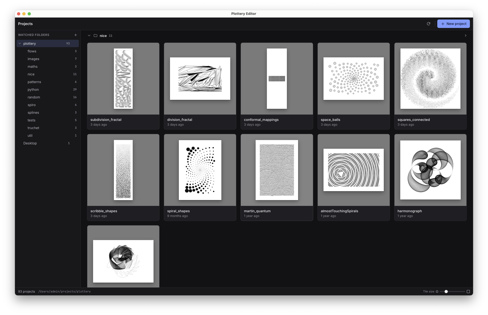

# Plottery Editor

Part of [**Plottery**](../README.md), a generative art engine for pen-plotters.

The macOS desktop app to manage, preview and plot **Plottery** projects. Install it with the one-line [install script](../README.md#install), or download the DMG from the [releases](https://github.com/TobiasGrothmann/plottery/releases).



- **Project browser:** your project folders as tiles with previews. Create new projects from here.
- **Params panel:** every field of a project's `Params` as a widget, with sections and tooltips. Changes re-run the project.
- **Hot reload:** saving a source file rebuilds and re-renders the project.
- **Layers:** inspect the sublayers of the result and toggle them in the preview.
- **Plotting:** send the result to a [Plottery server](../server) and control the plotter remotely.



## Build from source

Needs the [Dioxus CLI](https://dioxuslabs.com/learn/0.7/getting_started) (`dx`):

```sh
cd editor
dx serve            # run a dev build
```

`./scripts/release_editor.sh <version> false` builds the release DMG without uploading it. See [DEVELOPMENT.md](../DEVELOPMENT.md).
