# plottery_fonts

65 single-line fonts for pen plotters, laser cutters, CNC engravers and anything else that draws strokes instead of filling shapes. All of them are free to redistribute, the licences and credits ship with the crate.

The crate is pure data with no dependencies: every font is embedded with `include_bytes!` and exposed through the `BundledFont` enum. It is made for [Plottery](https://github.com/TobiasGrothmann/plottery), but nothing in it depends on Plottery.

## Usage with Plottery

`plottery_lib` re-exports this crate and turns the fonts into geometry:

```rust
use plottery_lib::*;

let font = Font::bundled(BundledFont::HersheySans);
let layer = Text::new("Hello plotter", &font)
    .size(2.0) // em height in cm
    .to_layer(SampleSettings::default())?;
layer.write_svg("hello.svg".into(), 10.0)?;
```

## Usage without Plottery

Pick a font and feed the bytes to your own parser. `kind()` tells you what the bytes are:

```rust
use plottery_fonts::{BundledFont, FontKind};

let font = BundledFont::ReliefSingleLine;
let bytes: &[u8] = font.bytes();

match font.kind() {
    FontKind::Stroke => {}     // SVG 1.1 font: <glyph d="..."> strokes, plus <hkern> pairs
    FontKind::SingleLine => {} // TrueType whose contours are strokes: do not close them
    FontKind::Outline => {}    // TTF/OTF, the strokes live in its OpenType `SVG ` table
}

for font in BundledFont::ALL {
    let credit = font.credit();
    println!("{} by {} ({})", font.family(), credit.author, credit.licence.name());
}
```

`file_name()` gives the original file name, `credit()` the author, source URL and licence, and `Licence::text()` the full licence text for your "about" screen.

## Licences

Everything is under the [SIL Open Font License 1.1](https://github.com/TobiasGrothmann/plottery/blob/main/fonts/LICENSES/OFL.txt) or the [Hershey font licence](https://github.com/TobiasGrothmann/plottery/blob/main/fonts/LICENSES/HERSHEY.txt). Both allow commercial use and bundling. The Hershey licence asks that its acknowledgement travels with the data, so keep `LICENSES/` (or `Licence::Hershey.text()`) in anything you ship. Per-font credits are in [LICENSES/CREDITS.md](https://github.com/TobiasGrothmann/plottery/blob/main/fonts/LICENSES/CREDITS.md).

## Fonts

### Hershey

The classic plotter fonts by Dr. A. V. Hershey, SVG conversion by Windell H. Oskay. Latin-1 charset.

| Font | Sample |
|---|---|
| `HersheyGothicEnglish` | 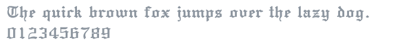 |
| `HersheyGothicGerman` | 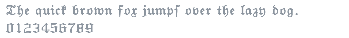 |
| `HersheyGothicItalian` | 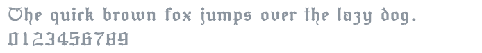 |
| `HersheySans` | 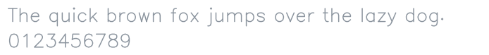 |
| `HersheySansMedium` | 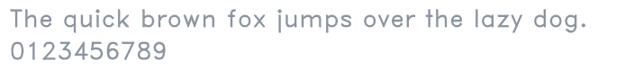 |
| `HersheyScript` | 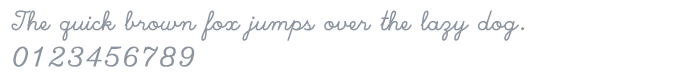 |
| `HersheyScriptMedium` | 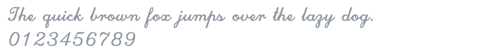 |
| `HersheySerif` | 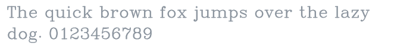 |
| `HersheySerifItalic` | 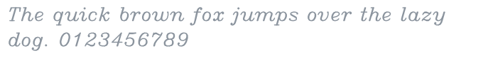 |
| `HersheySerifBold` | 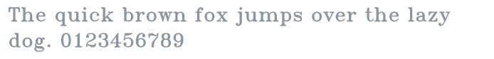 |
| `HersheySerifBoldItalic` | 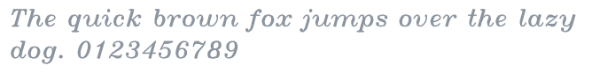 |

### Hershey extras

More Hershey sets converted by Shriinivas. Greek, Japanese and the markers map onto Latin letters, the symbol fonts (astrology, math, meteorology, music, symbolic) keep plain letters and put their symbols on digits and punctuation, Cyrillic uses real Cyrillic code points.

| Font | Sample |
|---|---|
| `HersheySansBold` | 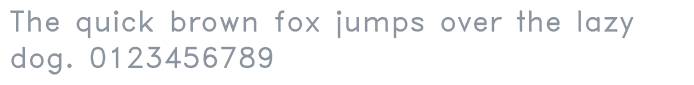 |
| `HersheyScriptAlt` |  |
| `HersheyAstrology` | 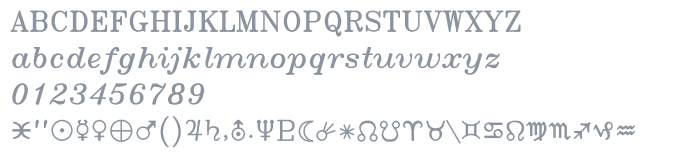 |
| `HersheyCyrillic` | 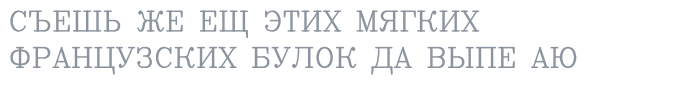 |
| `HersheyGreek` | 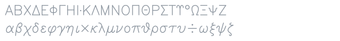 |
| `HersheyGreekMedium` | 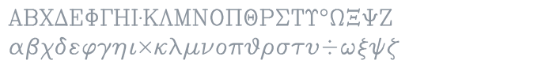 |
| `HersheyJapanese` | 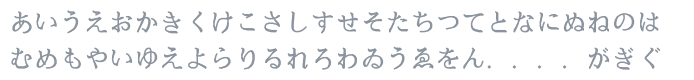 |
| `HersheyMarkers` |  |
| `HersheyMathLower` | 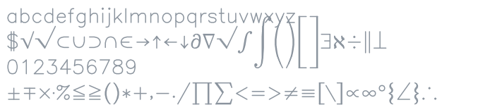 |
| `HersheyMathUpper` | 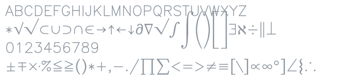 |
| `HersheyMeteorology` | 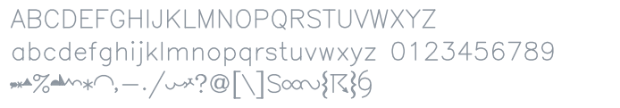 |
| `HersheyMusic` | 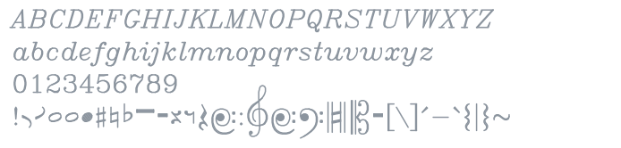 |
| `HersheySymbolic` | 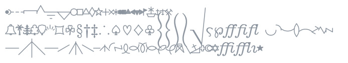 |

### EMS

Fonts drawn for plotters by Sheldon B. Michaels and Windell H. Oskay at Evil Mad Scientist Laboratories.

| Font | Sample |
|---|---|
| `EmsAllure` | 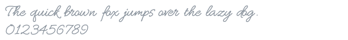 |
| `EmsBird` |  |
| `EmsBirdSwashCaps` |  |
| `EmsBrush` | 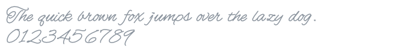 |
| `EmsCapitol` | 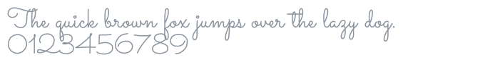 |
| `EmsCasualHand` |  |
| `EmsDecorousScript` |  |
| `EmsDelight` | 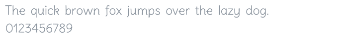 |
| `EmsDelightSwashCaps` | 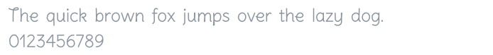 |
| `EmsElfin` |  |
| `EmsFelix` |  |
| `EmsHerculean` | 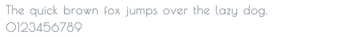 |
| `EmsInvite` | 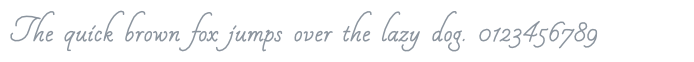 |
| `EmsLeague` | 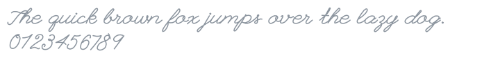 |
| `EmsLittlePrincess` | 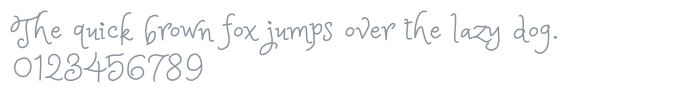 |
| `EmsMistyNight` |  |
| `EmsNeato` |  |
| `EmsNixish` | 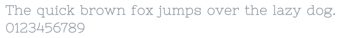 |
| `EmsNixishItalic` | 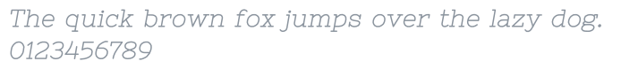 |
| `EmsOsmotron` | 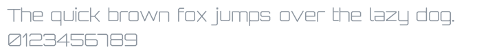 |
| `EmsPancakes` | 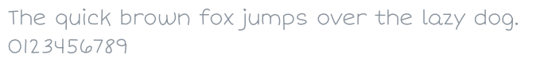 |
| `EmsPepita` |  |
| `EmsQwandry` | 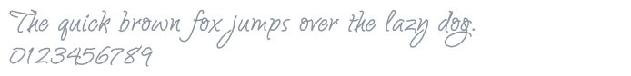 |
| `EmsReadability` | 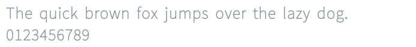 |
| `EmsReadabilityItalic` | 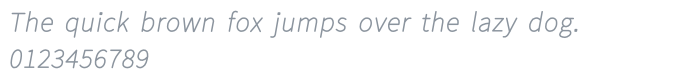 |
| `EmsSociety` | 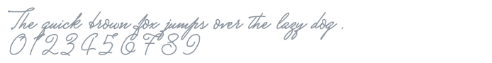 |
| `EmsSwiss` |  |
| `EmsTech` | 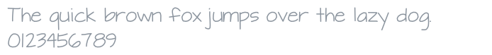 |
| `TwinSans` |  |

### Cutlings

Single-stroke fonts by Ellen Wasbo.

| Font | Sample |
|---|---|
| `CutlingsDualis` | 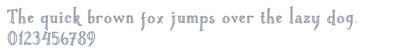 |
| `CutlingsGeometric` |  |
| `CutlingsGeometricRound` |  |
| `CutlingsPluralis` |  |
| `CutlingsSingularis` |  |

### Custom

Stroke fonts by Shriinivas, derived from Square Grotesk and Pinyon Script.

| Font | Sample |
|---|---|
| `CustomScript` | 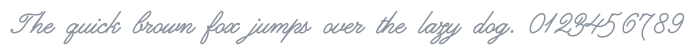 |
| `CustomSquare` | 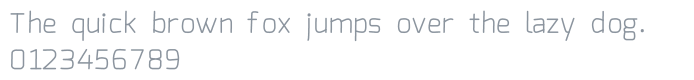 |
| `CustomSquareItalic` | 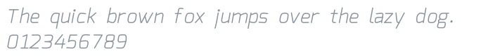 |

### Single-line TrueType and OpenType-SVG

Real font files with proper kerning. Relief stores its strokes as open TrueType contours, Mistral and Zniko keep them in an OpenType `SVG` table.

| Font | Sample |
|---|---|
| `ReliefSingleLine` | 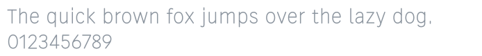 |
| `ReliefSingleLineOrnament` | 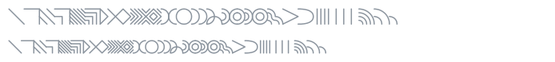 |
| `MistralSingleLine` |  |
| `Zniko` |  |
