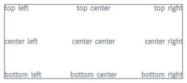
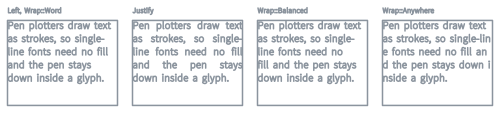
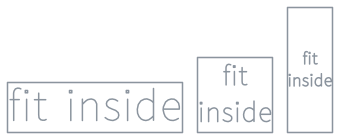
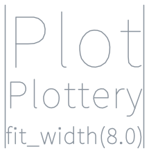
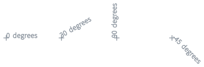
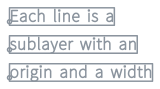

# Text layout

Use cases for the [`Text`] builder.

## Anchor to a rect

[`Text::in_rect`] puts the block on the rect edge chosen by the alignments and wraps at the rect's width.

```rust
# use plottery_lib::*;
# let font = Font::bundled(BundledFont::EmsReadability);
# let settings = SampleSettings::default();
# let rect = Rect::new(V2::zero(), V2::new(12.0, 5.0));
let layer = Text::new("top right", &font)
    .size(0.5)
    .in_rect(rect)
    .align(TextAlign::Right)
    .vertical_align(VerticalAlign::Top)
    .to_layer(settings)?;
# Ok::<(), anyhow::Error>(())
```



## Wrapping and justify

[`Wrap::Word`] breaks at spaces and after hyphens, [`Wrap::Balanced`] keeps the line count but evens out the lengths, [`Wrap::Anywhere`] breaks between characters. [`TextAlign::Justify`] stretches the spaces of every line but the last.

```rust
# use plottery_lib::*;
# let font = Font::bundled(BundledFont::EmsReadability);
# let settings = SampleSettings::default();
# let column = Rect::new(V2::zero(), V2::new(4.4, 3.4));
# let paragraph = "Pen plotters draw text as strokes.";
let layer = Text::new(paragraph, &font)
    .size(0.42)
    .in_rect(column)
    .align(TextAlign::Justify)
    .wrap(Wrap::Balanced)
    .vertical_align(VerticalAlign::Top)
    .to_layer(settings)?;
# Ok::<(), anyhow::Error>(())
```



## Fit inside a box

[`Text::fit_inside`] picks the largest em size whose wrapped block fits the rect by its font metrics. Ink can overhang a little, [`Fit::fit_inside`](crate::Fit::fit_inside) on the finished layer is exact.

```rust
# use plottery_lib::*;
# let font = Font::bundled(BundledFont::EmsReadability);
# let settings = SampleSettings::default();
# let rect = Rect::new(V2::zero(), V2::new(7.0, 2.0));
let layer = Text::new("fit inside", &font)
    .fit_inside(rect)
    .wrap(Wrap::Balanced)
    .align(TextAlign::Center)
    .vertical_align(VerticalAlign::Center)
    .to_layer(settings)?;
# Ok::<(), anyhow::Error>(())
```



## Fit a width

[`Text::fit_width`] sizes the text so its widest line is exactly that wide, nothing wraps.

```rust
# use plottery_lib::*;
# let font = Font::bundled(BundledFont::EmsReadability);
# let settings = SampleSettings::default();
let layer = Text::new("Plottery", &font)
    .fit_width(8.0)
    .vertical_align(VerticalAlign::Top)
    .to_layer(settings)?;
# Ok::<(), anyhow::Error>(())
```



## Rotation

[`Text::rotation`] turns the finished block around its anchor point.

```rust
# use plottery_lib::*;
# let font = Font::bundled(BundledFont::EmsReadability);
# let settings = SampleSettings::default();
# let anchor = V2::zero();
let layer = Text::new("30 degrees", &font)
    .size(0.6)
    .at(anchor)
    .rotation(Angle::from_degrees(30.0))
    .to_layer(settings)?;
# Ok::<(), anyhow::Error>(())
```



## Per-line data

[`Text::layout`] returns every line with its origin, width and glyph range, [`TextLayout::to_layer_by_line`] makes one sublayer per line.

```rust
# use plottery_lib::*;
# let font = Font::bundled(BundledFont::EmsReadability);
# let settings = SampleSettings::default();
let layout = Text::new("Each line is a\nsublayer with an\norigin and a width", &font)
    .size(0.7)
    .layout()?;
let metrics = font.metrics(0.7);
let mut layer = layout.to_layer_by_line(settings);
layer.push_layer(Layer::new_from(layout.lines.iter().map(|line| {
    Rect::new_shape(
        line.origin + V2::up() * metrics.descender,
        line.origin + V2::new(line.width, metrics.ascender),
    )
})));
# Ok::<(), anyhow::Error>(())
```


